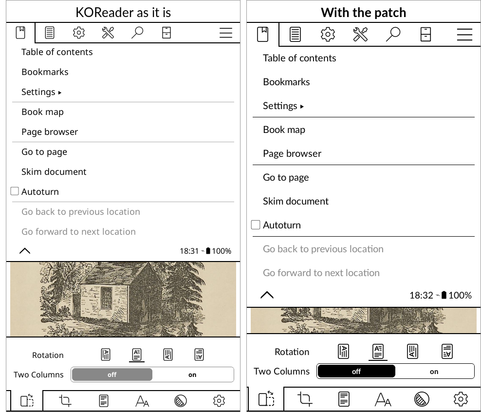
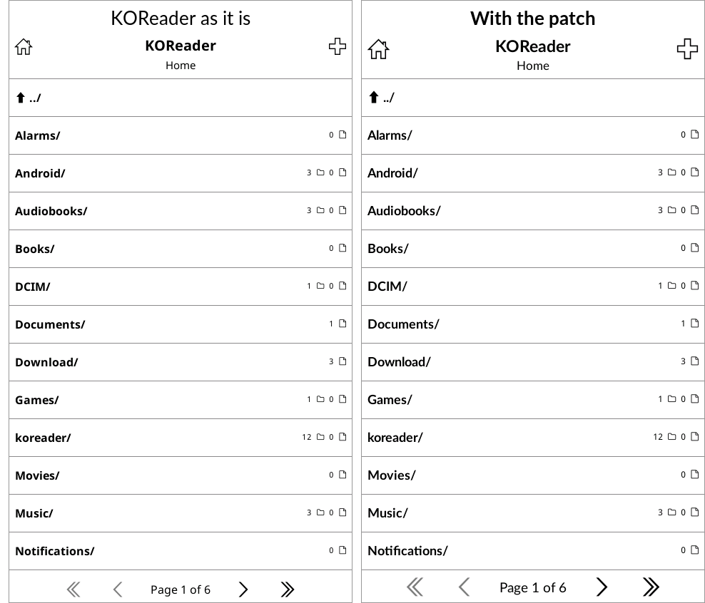
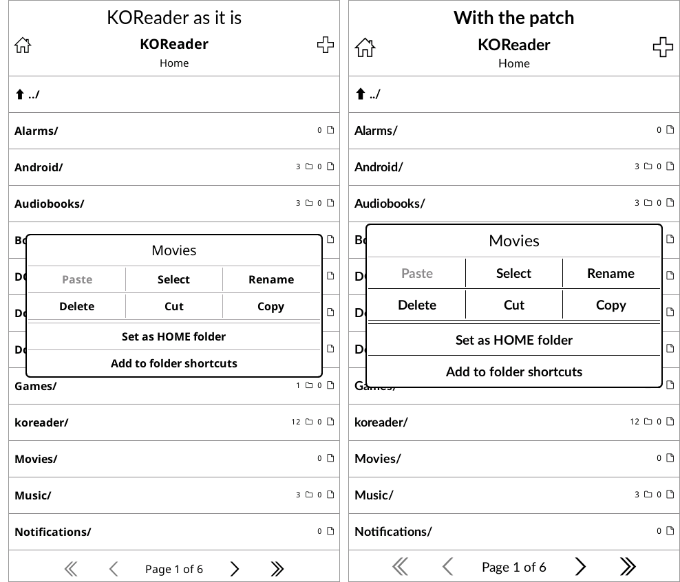

# KOReader for the Kompakt

[KOReader](https://github.com/koreader/koreader) is the best reader there is for an E Ink phone, but it was drawn for Kindles and Kobos: small grey type, tight rows and small icons, which on the Kompakt's 4.3" screen are hard to read and hard to hit. This is one small patch that makes KOReader's menus, lists and dialogs read like the Kompakt's own apps.



## What it changes

- The interface in **Lato**, the typeface of the Kompakt's own apps.
- All interface type a size larger: menus, lists, dialogs, the status bar and the settings panel.
- Icons a size larger, in the menu bars, title bars and the settings panel.
- Taller rows in the top menu, and taller buttons in dialogs.
- Lines and switches in **black**. KOReader draws them grey, and grey on this screen is dithered into a faint speckle.
- Dialogs with a firmer edge.

The text of your books is not touched. That stays whatever you choose in the book.





## How it works

KOReader runs any file it finds in its `koreader/patches/` folder when it starts. This is one of those files, so KOReader itself is not changed, and it keeps updating as usual. Nothing is written into KOReader's settings: delete the file and KOReader looks exactly as it did.

## Installing

Download `koreader-kompakt.zip` from the [latest release](../../releases/latest). Inside is a `koreader` folder holding:

```
koreader/patches/2-kompakt-look.lua
koreader/fonts/Lato-Regular.ttf
koreader/fonts/Lato-Bold.ttf
```

KOReader keeps its own `koreader` folder at the top of the phone's storage, beside `Download` and `Music`. Copy the `patches` and `fonts` folders into it, merging with any already there, then close KOReader and open it again.

Without the two fonts the patch still works and keeps KOReader's own typeface; everything else applies.

## Removing it

Delete `koreader/patches/2-kompakt-look.lua` and restart KOReader. The two fonts can stay or go.

## Licence

The patch is GPL-3.0-only. Lato is by Łukasz Dziedzic, under the SIL Open Font License 1.1, included as `koreader/fonts/OFL.txt`.
